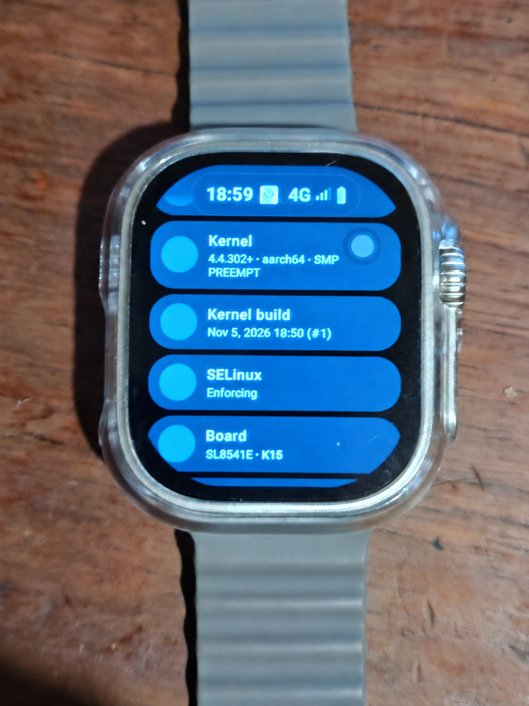

# Hands-on kernel research: building and backporting with AI

**Status: research in progress; preliminary CVE candidate counts.**

## Subject

A 4.4.83-based kernel of a legacy Android smartwatch, studied as a personal research project. The devices run
recently built kernels on this 2017 base. Binary comparisons detected some later fixes; fixes without a
detectable fingerprint are outside that comparison.

## Research objective

Assess the viability of AI-assisted kernel building and backporting for maintaining a legacy device.
The work is hands-on: build the kernel, adapt known upstream CVE fixes to the older tree, review the changes,
resolve integration problems and test the resulting builds on real hardware. The focus is the complete
maintenance workflow and its observed results.

This brief shares the research method, candidate classifications and functional test observations.
Kernel source releases, downloadable builds and patch distribution are outside this repository's scope.

## Method (summary)

- Triage: CVEs in a public kernel CVE dataset, matched against files listed in the build's own dependency
  records, with architecture and build-scope review completed for the target ARM64 kernel.
  Candidate matching alone is not proof that a vulnerability is exploitable.
- Categories per CVE: fixed (by a stable/LTS merge or by my backport), not affected (with evidence),
  needs a design decision, deferred (reachable only with high privileges), open.
- Binary check of stock kernels for fixes that can be detected in a binary.
- Backports: batched by subsystem, ported and compiled by AI agents, reviewed by a second, independent model,
  ambiguous cases decided by me, selected builds functionally tested on real hardware. Rules: no fix without
  an upstream reference; privileged or unclear paths go to me, not the model.

## Preliminary candidate counts

- Stock 4.4.83 base: 1,254 CVE candidates whose upstream fixes touch files in the build's dependency records
  (about 1,250). This is not a count of confirmed exploitable vulnerabilities.
- Binary check: we checked three stock kernel images for detectable signatures of 84 CVE fixes.
  Seven fixes were detected in each image, all associated with CVEs from 2017-2018. None of the 75
  checked fixes associated with CVEs from 2019 onward were detected. This method cannot assess fixes
  that leave no detectable signature in the binary. These are 84 selected fixes, not the entire CVE ledger.
- My kernel: Linux 4.4.302 (final upstream 4.4 LTS) + CIP 4.4 backports + my backports.
  The current ledger marks 975 candidates fixed: 603 through earlier kernel updates and
  372 through my CVE backports. Of the remainder, 53 are reviewed as not affected or already present,
  6 need a design decision, 4 are deferred and 216 remain open.

The [full 4.4 CVE candidate ledger](CVE_LEDGER.tsv) records each candidate's stock and custom-kernel
classification, fix reference, full affected-file list and description.

## Hardware validation

Functional bench tests of selected builds on one watch covered graphics, audio, Wi-Fi, Bluetooth,
LTE data and deep sleep, including a 20-minute stability run. A second watch received a pilot installation.
This is functional coverage of selected builds, not validation of every CVE fix or every device variant.
The watch in the photo was used for these tests with SELinux enforcing.

One lesson from the bench: an inherited upstream stable change caused an audio-path crash on the target
hardware. The build passed; the bench test exposed the crash.

The watch used for testing, reporting Linux 4.4.302+ and SELinux enforcing, with a 4G indicator.
